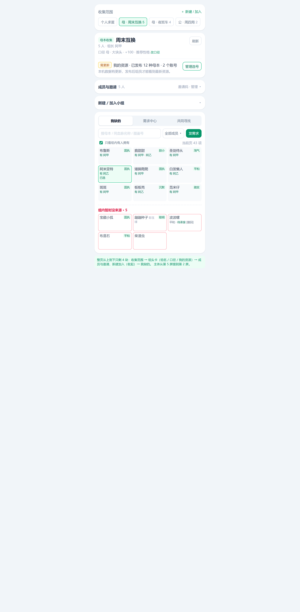
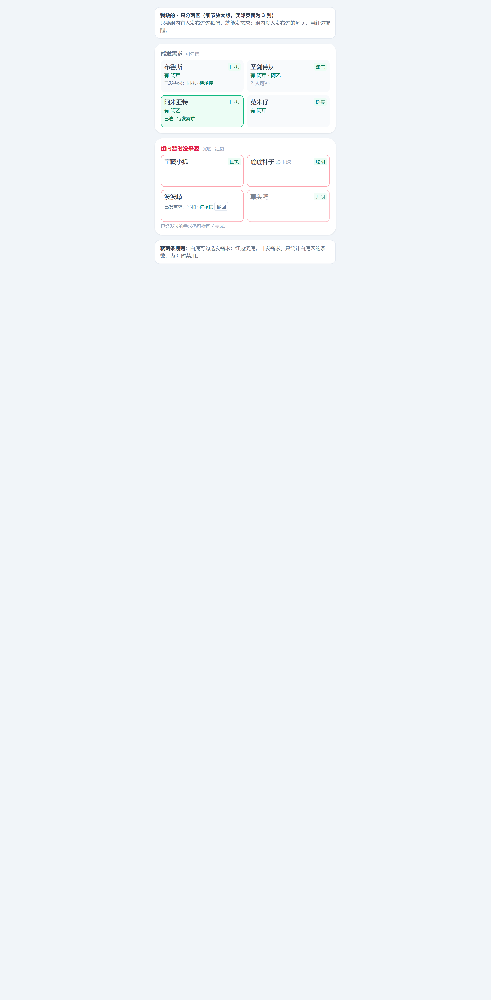
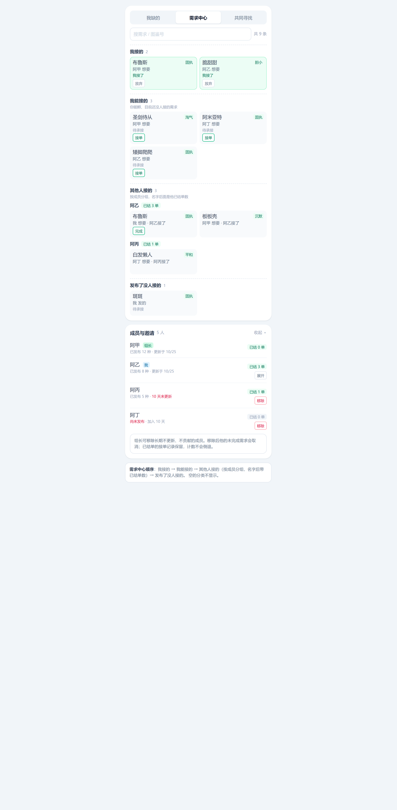
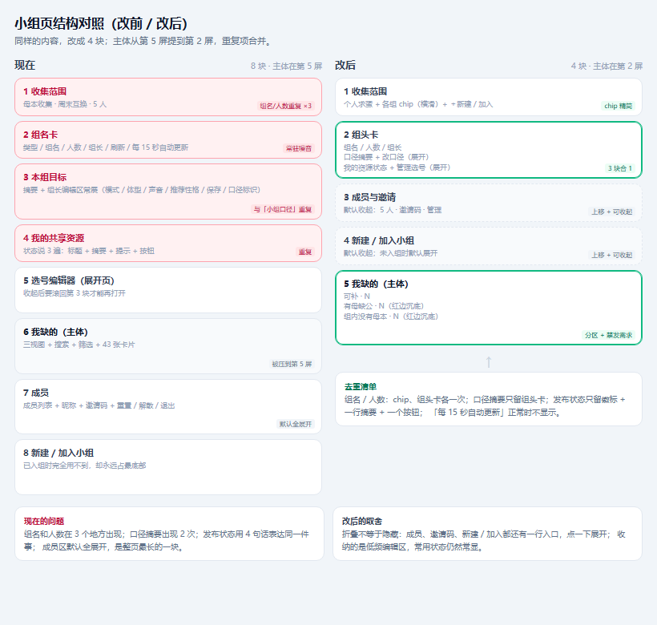
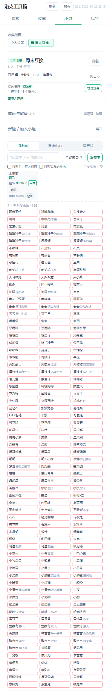
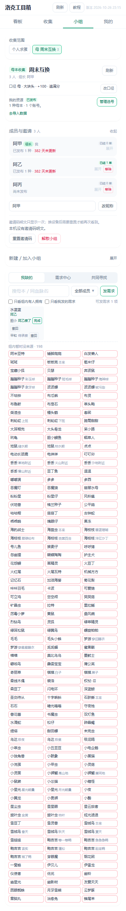
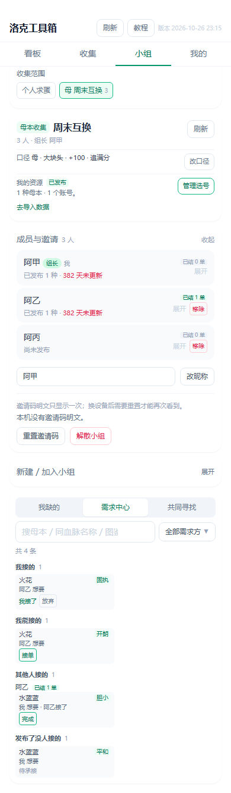

# 小组页精简 +「我缺的」两区（方案 v4 · 已实施）

> 来源：2026-10-26 用户反馈。方案 + 实施记录，代码已落地。
> 目标：**一屏内看到主体（我缺的）**；「组内补不了」的精灵一眼能认出来，且不会误发需求。

## 0. 一句话方案

1. 「我缺的」只分两区：**能发需求 / 组内暂时没来源**；后者沉底、红边，不加文字，也不能勾选。
   不做配对判断，最轻量（详见 §2）。
2. 小组页把「组名 / 本组目标 / 我的资源」**合成一张组头卡**，只留一行摘要；口径编辑、选号编辑器都收进展开。
3. 「成员与邀请」和「新建 / 加入小组」**上移到组头卡下面**，默认收起，只留一行标题。
4. 「我能补的」改名 **需求中心**：我接的 → 我能接的 → 其他人接的（按成员分组，带已结单数）→ 发布了没人接的（详见 §3.5）。
5. 组长可以**移除组员**；成员区显示每人的已结单数（详见 §3.6）。

### 0.1 设计稿（390px 手机宽度）

| 截图                                                     | 看什么                                                        |
| -------------------------------------------------------- | ------------------------------------------------------------- |
|          | 改后整页：4 块；收集范围 → 组头卡 → 成员/新建（收起）→ 我缺的 |
|    | 我缺的两区细节：能发需求 / 组内暂时没来源                     |
|  | 需求中心四段 + 已结单计数 + 成员区的移除入口                  |
|  | 改前 8 块 vs 改后 4 块，以及重复项在哪                        |

> 截图是静态设计稿，不是线上截图。对应 HTML 在 `.preview/小组页方案v2-*.html`。

## 1. 现状

### 1.1 「我缺的」现在怎么排

- 数据层已经做了一次分区：[motherSharing.ts](file:///d:/desk/洛克工具箱/src/domain/motherSharing.ts#L129-L133)
  把「组内有人拥有」的排前面、「已发布成员均无」的排后面，但**两段之间没有任何视觉分隔**，
  卡片长得一模一样，用户看不出后面那些是「没人能补」的。
- 卡片文案是灰色的「组内无，另 N 人待发布」：[MotherGroupResources.tsx](file:///d:/desk/洛克工具箱/src/ui/MotherGroupResources.tsx#L796-L802)，
  弱到几乎看不见。
- 选择模式下所有行都能点选；批量发需求时还会把「组内无」的蛋一起发出去
  （[runBulk](file:///d:/desk/洛克工具箱/src/ui/MotherGroupResources.tsx#L374-L451) 没有过滤），
  结果是发了也没人能接。
- 种公组同构：[studSharing.ts](file:///d:/desk/洛克工具箱/src/domain/studSharing.ts#L165-L175)、
  [StudGroupResources.tsx](file:///d:/desk/洛克工具箱/src/ui/StudGroupResources.tsx)。

### 1.2 小组页现在从上到下

| #   | 区块                                             | 代码                                                                                         | 问题                                                  |
| --- | ------------------------------------------------ | -------------------------------------------------------------------------------------------- | ----------------------------------------------------- |
| 1   | 收集范围（个人 + 各组 chip）                     | [GroupSwitcher](file:///d:/desk/洛克工具箱/src/ui/CollectionGroups.tsx#L391-L440)            | chip 写「母本收集 · 周末互换 · 5 人」，与 2、7 重复   |
| 2   | 组名卡（类型、组名、人数、组长、刷新、同步状态） | [group-card](file:///d:/desk/洛克工具箱/src/ui/CollectionGroups.tsx#L135-L176)               | 「按已共享账号汇总」「每 15 秒自动更新」常驻          |
| 3   | 本组目标（摘要 + 组长编辑区）                    | [GroupTargetEditor](file:///d:/desk/洛克工具箱/src/ui/GroupTargetEditor.tsx#L196-L375)       | 组长编辑区常展，占大半屏；摘要与 7 的「小组口径」重复 |
| 4   | 我的共享资源（状态 + 摘要 + 提示 + 按钮）        | [PublicationCard](file:///d:/desk/洛克工具箱/src/ui/CollectionGroups.tsx#L496-L564)          | 状态在标题、正文、按钮里各说一遍                      |
| 5   | 选号编辑器（展开页）                             | [MotherResourceEditor](file:///d:/desk/洛克工具箱/src/ui/MotherResourceEditor.tsx)           | 本身可收起，但收起后要滚回第 3 张卡才能再打开         |
| 6   | 小组资源（三视图 + 搜索 + 筛选 + 卡片）          | [MotherGroupResources](file:///d:/desk/洛克工具箱/src/ui/MotherGroupResources.tsx#L513-L950) | 主体被压到第 5 屏                                     |
| 7   | 成员（列表 + 昵称 + 邀请码 + 解散 / 退出）       | [MotherGroupMembers](file:///d:/desk/洛克工具箱/src/ui/MotherGroupMembers.tsx)               | 默认全展开，最长的一块                                |
| 8   | 新建 / 加入小组                                  | [CollectionGroupSetup](file:///d:/desk/洛克工具箱/src/ui/CollectionGroupSetup.tsx)           | 永远在最底部，已入组时完全用不到                      |

## 2. 方案 A：「我缺的」只分两区

用户 2026-10-26 改口径：这里只关心**能发什么需求**；「有母缺公」和「组内没母本」不区分。

### 2.1 判定

| 分区               | 条件                                                                | 交互             |
| ------------------ | ------------------------------------------------------------------- | ---------------- |
| 能发需求           | `row.holders.length > 0`（组内至少 1 个已发布、口径可比的人有这只） | 可勾选、可发需求 |
| 不能发需求（沉底） | `row.holders.length === 0`                                          | 红边、不可勾选   |

- **未知成员不算「有」**，沿用既有口径（见 [产品交互规范 §4](file:///d:/desk/洛克工具箱/docs/产品交互规范.md#L127)）。
- **不做配对判断**：只要有人发布过这只，就允许发需求；对方缺不缺种公不在「我缺的」里算。
  理由：最轻量，不改共享摘要、不改服务端、不需要成员重发。
- 已发需求但还没结束的蛋**仍然沉底**，但保留「撤回 / 完成」操作。

### 2.2 视觉

- 分隔标题只有一条：`组内暂时没来源 · N`，不加副文案。
- 沉底卡片**只加红色边线，不加任何文字**：
  - `ring-1 ring-inset ring-rose-300`（用 ring 避免卡片高度跳变）。
- **列表底部的图例删掉**，卡片和分区标题已经说明清楚。
- 分隔标题只在两区都有内容时出现；搜索 / `只看组内有人拥有` 过滤后按结果重新分区。

### 2.3 选择与发需求

- 选择模式下，沉底卡片 `aria-disabled="true"`、不响应点击，也不显示「不可选」之类文字。
- 顶部按钮的可用性从「当前页有内容」改为「**能发需求区有条目**」：
  `selectableCount = 能发需求条数`；为 0 时按钮禁用。
- `runBulk` 发布前再过滤一次 `holders.length === 0`（防状态过期）。
- 「共同寻找」不受影响：它本来就是「大家都缺、一起认领」的出口。

### 2.4 种公组

**本轮不改**（用户 2026-10-26：先改母本，种公后面单独做）。方案保留给下一轮：同一套两区 + 红边。

### 2.5 配对判断：本轮不做

之前讨论过「有母本但同账号没有可配公」，需要给共享摘要加字段、改服务端校验、成员重新发布。
用户改口径后认为它不关键，本轮**取消**：

- 不新增 `noPairingEggGameIds`，不改 `SharedMotherAccount`、签名 / 差分、服务端校验。
- 有母本但缺种公的成员仍会被算作「有」，可以发需求；缺公的问题由组员看到后自行处理。
- 以后若「发了需求但对方有母没公」的情况多，再单独立项。

## 3. 方案 B：小组页重排

### 3.1 改后结构（组模式）

```
┌ 收集范围 ──────────────────────────────┐
│ 个人求蛋 | 母 周末互换(5) | 母 夜班车(4)  →横滑 │
│                                   [＋ 新建 / 加入] │
└────────────────────────────────────────┘
┌ 周末互换  [母本收集]                       [刷新] ┐
│ 5 人 · 组长 阿甲 · 口径 母·大块头·+100·推荐性格      │
│ 我的资源 [需更新] 已发布 12 种 · 2 个账号  [管理选号]  │
│   └（点「管理选号」/「改口径」才展开，互不打扰）        │
└────────────────────────────────────────┘
┌ 成员与邀请  5 人                        ▼ ┐  ← 默认收起
└────────────────────────────────────────┘
┌ 新建 / 加入小组                          ▼ ┐  ← 默认收起
└────────────────────────────────────────┘
┌ 我缺的 | 需求中心 | 共同寻找                    ┐
│ [搜索…]              [筛选成员 ▼] [发需求]      │
│ 当前页 37 项                                │
│ 卡片 卡片 卡片 …                            │
│ ── 组内暂时没来源 · 6 ────────────────────   │
│ 红边卡片（不可勾选，不加文字）…                │
└────────────────────────────────────────┘
```

- 第 4 步「选号编辑器」跟随组头卡的开关，展开位置就在组头卡下方，不再被成员区隔开。
- 个人求蛋模式保持现状：收集范围 → 个人求蛋 → 新建 / 加入（展开）。

### 3.2 合并与去重清单

| 重复项      | 现状                                                | 改后                                                             |
| ----------- | --------------------------------------------------- | ---------------------------------------------------------------- |
| 组名 + 人数 | 收集范围 chip、组名卡、成员区标题、成员区副标题     | chip 只写「类型字 + 组名(人数)」；组头卡写一次；成员区标题写人数 |
| 小组口径    | 本组目标摘要 + 资源区「小组口径」                   | **删掉资源区那行**，只留组头卡                                   |
| 目标编辑    | 组长编辑区常展                                      | 组头卡「改口径」展开；非组长不渲染                               |
| 发布状态    | 标题 + 摘要 + 提示 + 按钮文案                       | 徽标（未发布 / 已发布 / 需更新）+ 一行摘要 + 一个主按钮          |
| 同步状态    | 「刷新」+「每 15 秒自动更新」+「正在更新小组数据…」 | 正常时不显示；离线 / 限流 / 刷新中才显示一行小字                 |
| 视图说明    | 「只列组员已发布、你能孵的需求单」常驻              | 只放在空态文案里                                                 |
| 资源区标题  | 「小组资源」+ 分段 + 口径                           | 删标题，分段控件自己说明                                         |

### 3.3 折叠交互

| 区块                           | 默认                           | 说明                                                 |
| ------------------------------ | ------------------------------ | ---------------------------------------------------- |
| 组头卡                         | 常显（只有 3 行）              | 组名、口径摘要、我的资源状态                         |
| 改口径（组长）/ 用我的目标更新 | 收起                           | 点击在组头卡内展开原 [GroupTargetEditor] 编辑块      |
| 选号编辑器                     | 收起                           | 沿用现在的开关，只是入口并入组头卡                   |
| 成员与邀请                     | 收起                           | 标题行右侧显示人数 +「邀请码」文字入口（组长）       |
| 新建 / 加入小组                | 收起（已入组）/ 展开（未入组） | 收集范围右侧常驻「＋ 新建 / 加入」，点开就是同一表单 |
| 折叠状态                       | 不跨会话保存                   | 切组时随组件 key 重置，不记忆上次展开                |

### 3.4 分组边界

- 已入组但 `hook.accountId` 为空（理论上不会）保持现状，不做特殊处理。
- 组详情加载中 / 离线缓存先出内容，沿用现有逻辑，折叠不改变缓存优先策略。

### 3.5 需求中心（原「我能补的」）

只改展示名，视图 id 仍是 `mine`（不清用户上次选中的视图）。固定四段，空段不显示：

| 顺序 | 段             | 内容                                                                                        | 动作                         |
| ---- | -------------- | ------------------------------------------------------------------------------------------- | ---------------------------- |
| 1    | 我接的         | `claimerAccountId = 我` 且 `status = claimed`                                               | 放弃                         |
| 2    | 我能接的       | `status = open`、我持有这颗蛋、不是我的需求                                                 | 接单                         |
| 3    | 其他人接的     | `status = claimed` 且 `claimerAccountId ≠ 我`；**按承接人分组**，组标题「阿乙 · 已结 3 单」 | 需求方是我时给「完成」       |
| 4    | 发布了没人接的 | `status = open`，且不属于「我能接的」（我发的 / 我孵不了的）                                | 无；撤回仍在「我缺的」卡片里 |

- 每段标题带条数；「其他人接的」的分组标题显示该成员已结单数。
- **不做批量接单**：四段混排时批量语义不清；保留单条接单 / 放弃 / 完成。
- 搜索沿用蛋名 / 同血脉 / 图鉴号；成员筛选在需求中心表示「需求方」。
- 「已结单」= 该成员在本组 `status = done` 且 `claimerAccountId = 他` 的需求条数（全时段）。
- **已完成的需求不可撤回**：前端不显示撤回，服务端也拒绝删除 `done`，否则已结单计数会倒退。
- 不需要新接口：`listCollectionDemands` 已经返回全部状态
  （[collectionGroupsStore.ts](file:///d:/desk/洛克工具箱/functions/_lib/collectionGroupsStore.ts#L1464-L1477)）。

### 3.6 组长移除组员

- 新接口 `DELETE /api/collection-groups/:groupId/members/:memberAccountId`：
  **仅组长**、不能移除自己（自己走退出 / 解散），目标必须是本组成员。
- 复用退出清理：释放他认领的任务与需求、`resource_epoch + 1`、删除成员（共享资源级联删除）。
- 额外取消他**未完成**的需求（`open` / `claimed`），避免人走了还在需求中心挂着；
  `done` 保留，用于已结单计数。
- 成员区：组长在每个非自己的成员行上看到「移除」，二次确认写明
  「共享资源与未完成需求会删除，已结单计数保留」。
- 成员行同时显示「已结 N 单」和「N 天未更新」（超过 7 天标红），方便组长判断谁该移除。
- 被移除的人仍可用邀请码重新加入（不想要就重置邀请码，现有能力）；不做封禁名单。
- 不改表结构，不加迁移。

## 4. 需要你拍板的点

| #   | 问题                                     | 状态 / 推荐                                                                 | 备选                     |
| --- | ---------------------------------------- | --------------------------------------------------------------------------- | ------------------------ |
| D1  | 「不能发需求」怎么判定？                 | **已定：只按「组内有没有人发布过这只」判断；不做配对**（2026-10-26 改口径） | —                        |
| D2  | 沉底区是否一律禁止发需求？               | **已定：一律禁止**                                                          | —                        |
| D3  | 红边区是否给「共同寻找」入口？           | **已定：不给**，保持轻量；红边卡片不加文字                                  | 给一个文字链             |
| D4  | 种公组是否同步改？                       | **已定：本轮不改**，种公后面单独做                                          | —                        |
| D5  | 成员区默认收起，邀请码入口放哪？         | 收起时标题行右侧「5 人 · 邀请码」，点击展开并滚到邀请码                     | 收起时完全不露出邀请码   |
| D6  | 「＋ 新建 / 加入」是否常驻收集范围右侧？ | 常驻；表单仍收起                                                            | 只在成员区下方出现       |
| D7  | 口径里的「修订 r」是否还显示？           | 收进「改口径」展开区，常显只看口径内容                                      | 一直显示在组头卡         |
| D8  | 「已结单」怎么算？                       | **已定：全时段**（本组内 `done` 且承接人是他的需求条数）；已完成不可撤回    | 只算近 30 天             |
| D9  | 需求中心还做批量接单吗？                 | **已定：不做**，只保留单条接单 / 放弃 / 完成                                | 只在「我能接的」段做批量 |
| D10 | 移除组员时他发的需求怎么处理？           | **已定：取消未完成（open / claimed），保留已完成用于计数**                  | 全部删除                 |
| D11 | 被移除的人能重新加入吗？                 | **已定：能**，邀请码仍有效；不想让他回来就重置邀请码                        | 加封禁名单（本轮不做）   |

## 5. 影响面

**代码**

- `src/ui/MotherGroupResources.tsx`：两区、红边、禁选、计数；需求中心四段与「已结单」标签。
- `src/ui/CollectionGroups.tsx`：组头卡合并、区块顺序、折叠、收集范围 chip 精简；把 `completedCounts` 与 `removeMember` 传给成员区。
- `src/ui/GroupTargetEditor.tsx`：改为「摘要行 + 可展开编辑」。
- `src/ui/MotherGroupMembers.tsx`：折叠开关、已结单数、组长移除入口。
- `src/ui/CollectionGroupSetup.tsx`：支持 `defaultOpen`。
- `src/ui/useCollectionGroups.ts`：`removeMember`；已结单数可由 `demands` 派生，不新增状态。
- `src/api/collectionGroups.ts`：`removeCollectionGroupMember`。
- `functions/_lib/collectionGroups.ts`：`DELETE .../members/:accountId` 路由（组长校验）。
- `functions/_lib/collectionGroupsStore.ts`：移除成员清理（复用 `leaveCollectionGroup` + 取消未完成需求）；撤回接口拒绝 `done`。
- `src/shared/collectionGroups.ts`：**不改数据形状**，只复用现有 `CollectionDemand`。

**测试**

- `src/ui/MotherGroupResources.test.tsx`：补「两区沉底 / 红边 / 禁选 / 发需求按钮可用性 / 需求中心四段与顺序 / 已结单标签」；
  既有 [L478](file:///d:/desk/洛克工具箱/src/ui/MotherGroupResources.test.tsx#L478) 顺序断言需同步改；
  「三视图顺序」用例里的「我能补的」改成「需求中心」。
- `src/ui/MotherGroupMembers.test.tsx`（新建）：组长能看到移除、非组长看不到、不能移除自己、已结单数展示。
- `tools/test/collection-groups-api.test.mjs`：移除权限 / 不能移除组长 / 释放承接 / 取消未完成需求 / 保留已完成；已完成需求不能撤回。
- e2e 断言依赖 `group-card` / `group-target-summary` / `group-edit-resources` / `mother-members`，
  **testid 全部保留**，只改位置与默认展开态；`e2e/mother-sharing.spec.ts` 需要补一次「展开成员」步骤。

**文档**

- `docs/产品交互规范.md` §4 小组页：补「我缺的两区」「需求中心四段」「已结单口径」「组长移除」四条。

## 6. 实施顺序（每步可单独发布）

1. **「我缺的」两区 UI**：能发需求 / 组内暂时没来源；沉底、红边（不加文字）、禁选、按钮可用性、单测。
2. **需求中心**：改名 + 四段顺序 + 按承接人分组 + 单条动作、单测。
3. **已结单计数**：前端派生、成员区展示；已完成需求不可撤回（前端 + 服务端）、测试。
4. **组长移除组员**：服务端接口与清理、客户端方法、成员区入口与确认、API 测试。
5. **组头卡合并**：组名 + 口径摘要 + 我的资源；删资源区口径行；e2e 回归。
6. **成员 / 新建加入上移 + 折叠**：默认收起，邀请码入口，设置表单收起。
7. **收集范围 chip 精简 + 同步状态收敛**：横滑、类型字、异常才显示状态。
8. **390px 实机截图核对**：一屏能看到三视图分段与至少一排卡片。

## 7. 明确不做

- 不做配对判断，不改共享摘要字段 / 签名 / 服务端发布校验（见 §2.5）。
- 不改缺口的目标全集与母本达标口径；只在展示层按 `holders` 分两区。
- 本轮不改种公组。
- 不新增「组整体完成度」视图。
- 不做批量接单、不做需求历史 / 统计报表。
- 不做封禁名单（移除后仍可用邀请码重新加入）。
- 不做折叠状态持久化。

## 8. 实施记录（2026-10-26）

已完成：

- 「我缺的」两区：组内有人有 → 可发需求；没人有 → 沉底红边、不可勾选、无卡片文字。
- 需求中心：我接的 / 我能接的 / 其他人接的（按承接人分组 + 已结单数）/ 发布了没人接的。
- 已结单：全时段按承接人统计；成员区展示；已完成需求前后端都禁止撤回。
- 组长移除组员：新接口 + 清理（释放承接、取消未完成需求、保留已完成）+ 成员区入口。
- 组头卡合并（组名 / 口径 / 我的资源）；成员与邀请、新建 / 加入默认收起并上移。
- 收集范围 chip 精简（母/公 + 组名 + 人数，横向滚动）；同步状态只在异常时显示。

验证命令与结果：

- `npx tsc -b`、`npx tsc -p functions/tsconfig.json --noEmit`：通过。
- `npx vitest run src/ui/MotherGroupResources.test.tsx src/ui/MotherGroupMembers.test.tsx src/ui/CollectionGroupSetup.test.tsx src/domain/demandStats.test.ts`：33 条通过。
- `npm run test:mother-groups:api`：35 条通过（含新增的移除 / 已完成不可撤回用例）。
- `npx playwright test e2e/mother-sharing.spec.ts e2e/refactor-fixes.spec.ts e2e/product-refactor.spec.ts`：18 条通过。
- 正式部署：2026-10-26，`https://roco-toolbox.pages.dev/`；线上入口 `assets/index-BTAoFLKR.js`
  与本地构建 SHA256 一致（`1C16E9CF…F2C976`）；`/api/collection-groups` 未登录返回 401（接口在线）。
- 追加（同日）：导入后待结单提醒（对方已接单 + 本机数据确实已有该蛋）、具体单列表与一键结单；
  成员区右侧「邀请码 · 管理」可点开。均已随新包一起上线。

实现截图：

- 
- 
- 
