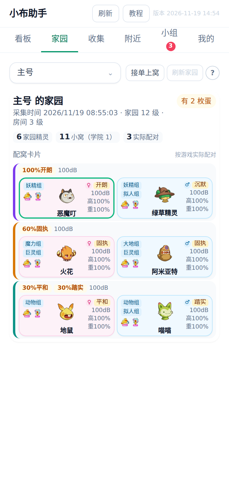
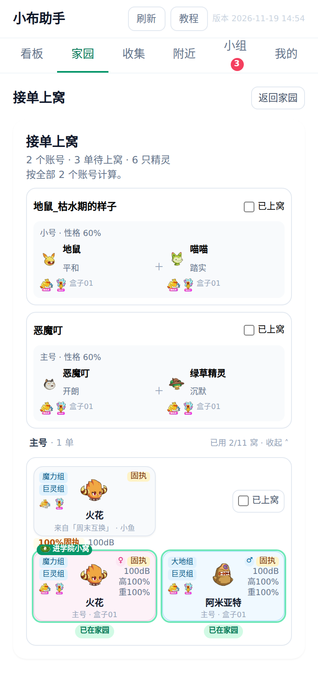

# 小组 + 接单上窝纯本地预览（开发用假数据）

> 2026-11-19 加。只解决一件事：**本地开发时小组页进不去、家园接单上窝看不到内容**，改界面全靠猜。

小组页的数据全在服务器（账号、邀请码、成员、需求中心、换蛋），本地跑 `npm run dev`
时既没有登录态也没有组，页面只剩一句「新建 / 加入小组、共享资源与成员管理都要先登录」。
这份假数据在浏览器里把同一套接口假出来，界面代码**一行不改**就能看、能点、能改。

## 怎么用

```bash
npm run dev
# 打开 http://localhost:5173/?mock=group
```

带上 `?mock=group` 就行，不需要账号，不需要邀请码。去掉参数即恢复成真实接口。

打开后是个假身份：**阿岚**，已经在「周末互换」小组里（4 人：林 / 阿岚 / 小鱼 / 默默）。
本机还带着两张假号（主号 / 小号）、各 6 / 2 只精灵和一份家园快照。
刷新页面 = 数据回到初始状态（所有改动只在内存里）。

## 能看到什么

| 区块 | 内容 |
| --- | --- |
| 组头卡 | 组名、人数、组长、我的资源状态（需更新 / 已发布） |
| 我的资源 | 本机两个号（主号 UID 10001、小号 UID 10002）→ 选号 → 预览覆盖增减 → 发布 / 更新 |
| 成员与邀请 | 4 人，含一个「尚未发布」的成员（验证「待发布」文案）；改昵称、重置邀请码、移出、退出 |
| 新建 / 加入小组 | 邀请码校验是假的（固定 `M0CK8888`） |
| 我的收集 | 我的想收需求（带「有匹配 / 待匹配」角标） |
| 组内广场 | 别人的需求，角标「我能给蛋 / 我能孵 / 接不了」 |
| 需求详情 → 发起换蛋 | 选供给 → 确认弹窗 → 真的生成换蛋单（走的是同一份 `applyEggAction`） |
| 蛋仓 | 3 颗蛋（已挂出 / 未挂出）、筛选、改标注 |
| 我的换蛋 | 4 张换蛋单（1 张待对方接受、3 张已接受），进度条、催进度、取消 |
| 机器人接入 | 已接入的假 QQ 群、今日查询 12/100 |
| 家园 · 家园现状 | 主号：11 个窝（1 个学院小窝）、6 只住户、3 对实际配对、2 枚蛋；小号同理但只有一对 |
| 家园 · 接单上窝 | 3 张「我接的 / 别人回我的」单：一张老单按本机背包现算母本 × 种公（带「已在家园」绿框），两张已定蛋线（显示父母、可勾「已上窝」） |

换蛋相关的操作（发布需求、挂出蛋、发起换蛋、接受、取消、上窝）**会真的改内存状态**，
因为 POST 直接复用 `src/shared/eggWorkflow.ts` 的 `applyEggAction`，规则和线上一致；
只是不落库，刷新就还原。






## 不会影响正式包

- 入口在 `src/main.tsx`：`import.meta.env.DEV && 地址带 mock` 才动态 `import()`；
- 生产构建里 `import.meta.env.DEV` 恒为 false，这段分支连同 `src/dev/**` 都不会进包；
- 假数据不写任何云端接口，`fetch` 只拦 `/api/**`，其它请求照常走网络。

## 接单上窝为什么单独造了家园数据

上窝要两样本机数据：**背包里的母本 / 种公** 和 **家园里的窝、住户、实际配对**。
原来的假数据只有背包的一部分（全是母本、没有家园），所以接单上窝要么「暂无接单」、
要么一进来全是「排不上」。现在按真实图鉴成对造：

- 三对亲本，母本是那颗蛋的物种（恶魔叮 / 火花 / 地鼠），公本取同蛋组的另一种，
  保证「母本 × 种公」配得出来；
- 家园快照里，排出来的母本 / 种公确实住在窝里，卡片上才会出现「已在家园」绿框；
- 换蛋单上的蛋线（`line` / `returnLine`）直接指向这些实例号，父母不会显示「亲本待更新」。

「已上窝」勾选走的是同一份换蛋状态（`applyEggAction` 的 `place`），老单 / 我供蛋 /
对方回我三条路都能勾；勾完只在内存里，刷新还原。

## 代码在哪

```
src/dev/mockGroup/
  data.ts      # 种子数据：组、成员、发布摘要、需求、蛋、换蛋单（精灵都取自真实图鉴）
  home.ts      # 接单上窝用：两张假号的背包精灵 + 家园快照（窝 / 住户 / 配对 / 蛋）
  api.ts       # 路由表：把 /api/collection-groups/** 映射到内存状态上的读写
  index.ts     # 安装：伪造登录态 / 组偏好 / 本机数据，接管 fetch
  api.test.ts  # 约束：响应必须能被客户端解析器接受（接口改字段时先在这里红）
  home.test.ts # 约束：三张接单在家园真能排出母本 × 种公、亲本实例号都在背包里
```

想加一条需求、换一批精灵，只改 `data.ts` 里的 `createEggWorkflow()` / `createGroupDetail()`；
想让接单上窝多几行，先看 `home.test.ts`——它会挡住「页面有单、却排不上」的假数据。

## 已知限制

- 只有一个组、一个「我」；多人协作的真实时序（别人同时接单、版本冲突）看不出来；
- 邀请码、机器人、群提醒都是死数据，不会真的发消息；
- 只有一套家园摆位（没有楼层切换、没有增量快照），巡查 / 产出那类数据仍然没有种子；
- 精灵头像走游戏 CDN（图片请求会出网），但**接口请求一个都不出网**；
- 搜到的精灵来自真实图鉴，但**需求、蛋、换蛋单、家园都是编的**，不要拿它当线上数据核对。
